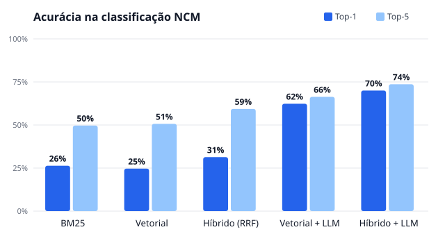

# NCM Finder

Classificador de produtos por **NCM** (Nomenclatura Comum do Mercosul): recebe a descrição de um produto e devolve os códigos de 8 dígitos mais prováveis. Usa busca semântica (embeddings + pgvector) e, no modo preciso, o **Claude** como reranker, que escolhe entre os candidatos e justifica pela hierarquia e pelas Regras Gerais de Interpretação do SH.

A avaliação é parte do produto: dataset rotulado versionado, baseline BM25, métricas top-1/top-5/MRR, relatório gerado por script e teste de regressão de acurácia no CI.



## Resultados atuais

Execução de 2026-09-28 sobre 300 produtos (**dataset v2**, rótulos revisados), com a tabela NCM vigente (Res. Gecex nº 926/2026, 10.515 códigos), embeddings **locais** `Xenova/bge-m3` (offline), busca híbrida e reranker **Claude Haiku 4.5** (`claude-haiku-4-5-20251001`, via Claude Code CLI) com 20 candidatos por produto. Relatório completo em [report/eval.md](report/eval.md); evidências produto a produto em [report/evidencias/](report/evidencias/).

| Sistema | Top-1 | Top-5 | Top-10 | MRR | Capítulo certo |
|---|---|---|---|---|---|
| BM25 (baseline) | 26,3% | 49,7% | 57,0% | 0,360 | 50,7% |
| Vetorial (bge-m3) | 24,7% | 50,7% | 60,3% | 0,357 | 59,0% |
| Híbrido BM25 + vetorial (RRF) | 31,3% | 59,3% | 69,3% | 0,430 | 61,0% |
| Vetorial + LLM (Haiku) | 62,3% | 66,3% | 67,3% | 0,642 | 84,0% |
| **Híbrido + LLM (Haiku)** | **70,0%** | **73,7%** | **75,0%** | **0,720** | **88,7%** |

### Evolução

| Rodada | Dataset | Embedding | Candidatos ao LLM | LLM | Top-1 do melhor sistema |
|---|---|---|---|---|---|
| 1 | v1 | e5-small | — | — | 25,0% (BM25) |
| 2 | v1 | e5-small | híbrido, k = 10 | Gemini 3.5 Flash Lite | 54,7% |
| 3 | v1 | **bge-m3** | **híbrido (c = 10), k = 20** | Claude Haiku 4.5 | 64,3% |
| 3 | **v2** | bge-m3 | híbrido (c = 10), k = 20 | Claude Haiku 4.5 | **70,0%** |

- **Rodada 2 → 3** mudou mais de uma variável (embedding, k e LLM), então o ganho de +9,6 p.p. não é atribuível a uma só. A contribuição da recuperação foi medida isoladamente: o código certo aparece entre os 20 candidatos híbridos em 76% dos produtos com bge-m3, contra 61% entre 10 com e5-small.
- **v1 → v2** não muda o sistema: são as mesmas 600 respostas do Haiku (0 chamadas novas), reavaliadas com rótulos corrigidos. 31 rótulos (10,3%) estavam errados, e em 19 deles o sistema já sugeria o código correto ([data/eval/revisao-rotulos-v2.md](data/eval/revisao-rotulos-v2.md)).

### O que os números mostram

- **Meta do planejamento atingida no limite: top-1 = 70,0%** (Híbrido + LLM, dataset v2), com 88,7% de acerto de capítulo. Ressalva: a revisão dos rótulos foi feita por IA, sem ver as previsões, e ainda aguarda validação por um profissional habilitado.
- **O LLM quase triplica o acerto do BM25** (26,3% → 70,0%).
- **A recuperação continua sendo o teto.** O código certo está entre os 20 candidatos em 77,3% dos produtos; o Haiku acerta 70,0%, ou seja, aproveita 91% do que é possível. O próximo ganho vem da busca (embedding de produção, sinônimos comerciais), não do LLM.
- **Trocar o embedding foi a melhoria mais barata** (sem custo de API). Comparação dos quatro modelos locais no dataset v2, em % de produtos cujo código certo está entre os k primeiros candidatos:

  | Modelo | Dim. | Tempo p/ indexar 10,5k NCMs | Vetorial k=10 | Vetorial k=20 | **Híbrido k=20** |
  |---|---|---|---|---|---|
  | multilingual-e5-small | 384 | ≈ 15 min | 40,7% | 49,7% | 69,0% |
  | multilingual-e5-base | 768 | ≈ 30 min | 41,7% | 51,3% | 69,3% |
  | multilingual-e5-large | 1024 | ≈ 50 min | 45,7% | 55,3% | 73,3% |
  | **bge-m3** (padrão) | 1024 | ≈ 30 min | **60,3%** | **67,7%** | **77,3%** |

  O bge-m3 vence em todos os k. O híbrido reduz a diferença entre os modelos, porque o BM25 compensa parte das falhas de vocabulário, mas não a elimina. (Com o e5-large, ordenar os textos por tamanho antes de montar os lotes derrubou a indexação de uma estimativa de ~10 h para ~50 min.)
- **A confiança do LLM separa bem certos de errados** (Híbrido + LLM, v2): com confiança ≥ 0,7 ele acerta 82% (209 de 255, cobrindo 85% dos produtos); com confiança < 0,7 acertou só 1 de 45. Em produção isso permite aceitar automaticamente as sugestões de alta confiança e mandar só o restante para revisão humana.
- **Gemini, rodada 2, preservada para comparação:** mesma metodologia com e5-small e k = 10 deu 54,7% de top-1 no dataset v1 (cache em `data/eval/cache-llm/gemini-3.5-flash-lite.json`).

## Arquitetura

```
apps/web (React)   apps/cli (commander)
        └───────┬───────┘
         apps/api (Fastify + Zod)
                │
      packages/core ── ports & adapters
      ├─ ingest/    tabela Siscomex → hierarquia → descrição enriquecida → embeddings (idempotente)
      ├─ pipeline/  normalizar → embed → buscar(k) → rerank → resposta (+ cache por hash)
      ├─ ports/     EmbeddingProvider · VectorStore · Reranker · ClassificacaoCache
      ├─ adapters/  voyage | local-transformers · pgvector | memória | arquivo · claude | noop · postgres | memória
      └─ eval/      métricas, BM25, RRF, relatório, embeddings int8
                │
     PostgreSQL + pgvector (HNSW parcial por modelo)      Claude API (tool use + prompt caching)
```

Decisões principais:

- **Ports & Adapters**: `pipeline/` não importa SDK de terceiros. Trocar Voyage por modelo local, ou pgvector por memória, não toca no classificador.
- **Descrição enriquecida**: cada NCM é indexado com a cadeia completa (capítulo > posição > subposição > item). Sem isso, milhares de itens se chamariam só "Outros".
- **Embeddings versionados por modelo**: a coluna `vector` não tem dimensão fixa e cada modelo ganha um índice HNSW parcial com cast (`voyage-3` = 1024, `e5-small` = 384). A ingestão pula códigos já indexados.
- **Rerank com structured output**: tool `escolher_ncm` com `strict: true`, validada de novo com Zod. `tool_choice: auto` porque modelos recentes rejeitam tool use forçado. Se o LLM inventa um código fora dos candidatos, o sistema usa a melhor alternativa válida com confiança reduzida. O system prompt (resumo das RGI) é fixo e cacheado; produto e candidatos vêm depois do breakpoint. Refusal fallback (`fallbacks: "default"`) ativado.
- **Privacidade**: o Fastify não loga o corpo das requisições, e o reranker loga só o motivo quando descarta uma resposta, nunca o prompt.

## Como rodar

Requisitos: Node 20+ e pnpm 9. Docker é opcional (só para o pgvector).

```bash
pnpm install
pnpm --filter @ncm-finder/core build
cp .env.example .env
```

**Sem banco e sem chaves (tudo offline):** a API e a CLI leem `data/ncm/*.json` e `data/embeddings/*.int8.bin`, que estão versionados.

```bash
pnpm --filter @ncm-finder/cli ncm classificar "tênis de corrida masculino" --modo vetorial
pnpm --filter @ncm-finder/api start          # http://localhost:3333
pnpm --filter @ncm-finder/web dev            # http://localhost:5173 (proxy /api → 3333)
```

**Com pgvector e Claude:**

```bash
docker compose up -d                         # postgres 16 + pgvector, schema em db/schema.sql
# .env: DATABASE_URL, VOYAGE_API_KEY (opcional), ANTHROPIC_API_KEY
pnpm ingest                                  # baixa a tabela do Siscomex e grava NCMs + embeddings
pnpm --filter @ncm-finder/cli ncm classificar "tênis de corrida masculino"
```

### API

`POST /classificar?modo=vetorial|vetorial+llm&k=10`

```json
{ "descricao": "Tênis de corrida masculino", "marca": "Acme", "categoria": "Calçados" }
```

Resposta: `candidatos[]` (NCM, descrição completa e score), `escolha` (`ncm`, `confianca`, `justificativa`, `alternativas`) e `cache`. Erros padronizados: `400 ENTRADA_INVALIDA`, `422 LLM_INDISPONIVEL`, `500 ERRO_INTERNO`. `GET /health` informa o modelo de embedding, o reranker e o armazenamento em uso.

### CLI

```bash
ncm classificar "<descrição>" [--modo vetorial|vetorial+llm] [-k 10] [--marca X] [--categoria Y] [--json]
ncm avaliar data/eval/produtos-rotulados.csv [--modo vetorial]
ncm ingerir [--arquivo siscomex.json] [--referencia AAAA-MM-DD]
```

## Avaliação

```bash
pnpm eval              # 300 produtos → report/eval.md + report/eval-chart.svg (LLM se houver ANTHROPIC_API_KEY)
pnpm eval --sem-llm    # sem custo de API
pnpm eval:regressao    # 50 produtos, falha se top-5 < data/eval/limiares.json (roda no CI)

# Rodada 3 (Claude Haiku via Claude Code CLI, usa o plano do usuário; retoma do cache se parar por limite)
RERANKER=claude-cli CLAUDE_CLI_MODEL=haiku K_LLM=20 LLM_CONCORRENCIA=5 pnpm eval --hibrido-llm
```

O relatório registra a versão da tabela NCM, o sha256 do dataset, os modelos e o k usados. A busca é exata (cosseno em memória), então os resultados são determinísticos. O dataset e seus critérios de rotulagem estão em [data/eval/README.md](data/eval/README.md). Os rótulos foram atribuídos com assistência de IA e validados contra a tabela, mas **ainda não passaram por revisão de um profissional de classificação fiscal**.

## Testes

```bash
pnpm test
```

- **core**: 108 testes, 99,8% de linhas cobertas. Cobrem ingestão, pipeline (vetorial e híbrido), os três rerankers (Claude API, OpenAI-compatível e Claude CLI) com chamadas simuladas, cache de respostas (incluindo um teste de regressão para escrita concorrente), métricas, BM25, relatório, evidências e container. A integração com pgvector (5 testes) roda com `DATABASE_URL` (CI) ou Testcontainers e é pulada sem Docker.
- **api** (7 testes, `inject()`), **cli** (6) e **web** (5, Testing Library).

## Estrutura

```
data/ncm/          tabela oficial bruta + NCMs enriquecidos (por data)
data/eval/         dataset rotulado, critérios, limiares de regressão
data/embeddings/   embeddings int8 (NCMs e consultas do dataset)
db/schema.sql      schema Postgres + pgvector
packages/core      domínio, ports, adapters, pipeline, ingestão, avaliação
apps/api | cli | web
scripts/           ingest.ts, eval.ts
report/            eval.md + eval-chart.svg (commitados como evidência)
```

## Próximos passos

1. Medir com `VOYAGE_API_KEY` (embedding de produção) para atacar o teto de recuperação, hoje em 77% no top-20 (dataset v2).
2. Separar o efeito de cada variável da rodada 3: Haiku com os candidatos da rodada 2 e Gemini com os da rodada 3 (as respostas já em cache reduzem o custo).
3. Expor a confiança na API/UI com um limiar (0,7) para encaminhar à revisão humana só os casos incertos.
4. Validação da v2 dos rótulos por um despachante ou consultor tributário habilitado, em especial os 10 casos ambíguos listados em `data/eval/revisao-rotulos-v2.md`.

Fora de escopo na v1: fine-tuning, CEST, exceções de TIPI, NCM por estado, multi-idioma.
